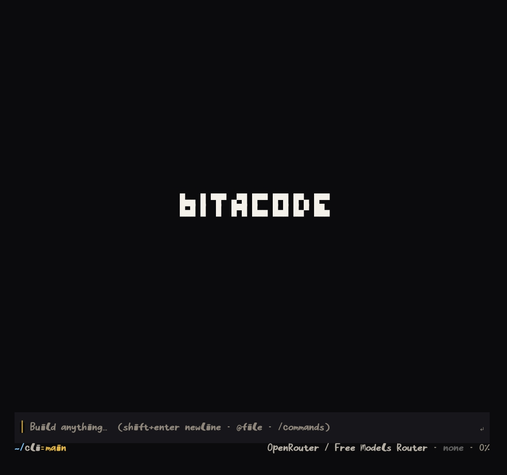

```
█▄▄ █ ▀█▀ ▄▀█ █▀▀ █▀█ █▀▄ █▀▀
█▄█ █  █  █▀█ █▄▄ █▄█ █▄▀ ██▄
```

[](https://github.com/soumik183/bitacode/actions/workflows/ci.yml)
[](https://github.com/soumik183/bitacode/actions/workflows/security.yml)
[](LICENSE)

<div align="center">



<br>

</div>

Bitacode is a small AI coding agent for your terminal. It reads your code, edits files, runs commands, and asks you when a decision is actually yours. No setup wall, no magic abstractions — open it and start typing.

It is written in TypeScript and short enough to read in an afternoon. Everything a real coding agent needs is in here: a streaming tool loop, approvals, sessions, MCP, skills, sub-agents, and live cost tracking. If you like understanding the tools you use, this one is built for you.

## Features

- **Multiple providers** — OpenAI, Anthropic, Gemini, and OpenRouter through one SDK.
- **Real tools** — file ops, search, shell, git, todos, plans, web search, sub-agents, and `ask_user`.
- **You stay in control** — `manual`, `auto`, and `yolo` approval modes; change them with `/settings`.
- **Terminal UI that behaves** — Markdown, syntax colours, stable scrolling, responsive layout, seven audited themes.
- **Sessions that survive** — conversations and todos save themselves; resume with `--session`.
- **Sub-agents you can inspect** — delegate, run in parallel, and browse every child transcript.
- **Honest usage numbers** — live tokens, context window, and estimated cost in the footer.

## Install

Pick what fits you:

```bash
npm install -g bitacode      # one global command
npx bitacode@latest          # no install at all
npm install bitacode         # as a project dependency
```

From source:

```bash
git clone https://github.com/soumik183/bitacode.git
cd bitacode
npm install
npm run dev
```

`dist/` is committed, so `node dist/cli.js` works too.

### Alternative: install script

`install.sh` does the same job in one command. By default it installs the published package from npm; pass `--source` to download the GitHub release tarball and build it locally instead (handy when the npm registry is blocked).

```bash
curl -fsSL https://raw.githubusercontent.com/soumik183/bitacode/main/install.sh | sh
# or, with wget:
wget -qO- https://raw.githubusercontent.com/soumik183/bitacode/main/install.sh | sh

# build from the GitHub release source instead of npm:
curl -fsSL https://raw.githubusercontent.com/soumik183/bitacode/main/install.sh | sh -s -- --source

# pin a version/tag:
VERSION=v0.1.25 sh install.sh --source
```

It needs Node/npm, plus `curl` or `wget` for the source mode. Run `sh install.sh --help` for all options.

### First run

`bitacode` opens the main screen immediately. If an API key is already in your environment (`OPENAI_API_KEY`, `ANTHROPIC_API_KEY`, `GEMINI_API_KEY`/`GOOGLE_API_KEY`, `OPENROUTER_API_KEY`, or `BITACODE_API_KEY`), it picks that provider and model for you. Otherwise you get a one-line hint and can configure from the screen.

Tip: type `/provider` to pick a provider (you'll be prompted for a key) and `/model` to pick a model.

Need to set things up from a script?

```bash
bitacode configure          # create global config, detect env keys, or open the picker
bitacode init               # create a runtime config and print its path
bitacode init --project     # <cwd>/.bitacode/bitacode.jsonc
bitacode init --user        # shared user config
bitacode init --project --force
```

Config lookup is deliberately boring: `<cwd>/.bitacode/bitacode.jsonc` first, then `~/.config/bitacode/bitacode.jsonc` on macOS/Linux (`~/AppData/Local/bitacode/bitacode.jsonc` on Windows). Project rules and hooks only load when the project is trusted.

### Update

```bash
bitacode update             # global install
bitacode update --local     # current project
bitacode update --check     # check only
```

## Headless / CI

One prompt, no TUI, optional JSON events. Exit code is `0` on success, so scripts and GitHub Actions just work.

```bash
bitacode -p "fix the failing test"
bitacode -p "review the diff" --json
bitacode -p "summarise the repo" --approval auto --provider openai --model gpt-4o-mini
bitacode -p "commit the change" --max-iterations 8 --save-session
```

`--cwd` sets the working directory; `--session <id>` resumes a saved one.

## Configuration, trust & automation

- `bitacode permissions show|trust|untrust|allow|deny|ask` — per-tool, per-command, per-path rules. Project rules need a trusted directory.
- `bitacode hooks` — `SessionStart`, `UserPromptSubmit`, `PreToolUse`, `PostToolUse` in `~/.config/bitacode/hooks.json` or `<repo>/.bitacode/hooks.json`.
- **Custom commands** — Markdown files in `~/.config/bitacode/commands/` or `<repo>/.bitacode/commands/`.
- **Plugins** — discovered from `~/.config/bitacode/plugins/`; manage with `bitacode plugins list|enable|disable|info`.
- `bitacode sessions list|show|replay|stats|journal|fork|rename|pin|export [id]` — your saved conversations.
- `bitacode doctor` — config, permissions, hooks, storage, terminal support.
- `bitacode completion bash|zsh|fish` — shell completion.

Bitacode also keeps a small durable memory (`fact`, `preference`, `decision`, `constraint`) and folds stable repo context into prompts to keep the provider cache warm.

## Commands

Slash commands work from the composer. Type `/` to see the full list with descriptions; filter as you type.

| Command | What it does |
|---|---|
| `/help` | Show keys, hints, and every command |
| `/new` | Start a fresh session |
| `/session` | Resume a saved session (`/session <id>` works too; `d` deletes in the picker) |
| `/find <text>` | Search the transcript (`Esc` clears) |
| `/subagents` | Browse and inspect child-agent transcripts |
| `/review` | Delegate a code review to a sub-agent |
| `/github` | Open the Bitacode repository in your browser (Chrome first on Android, then your default browser) |
| `/bug` | Open the GitHub new-issue form to report a bug |
| `/model` | Switch model |
| `/provider` | Switch provider or add an API key |
| `/variant` | Set reasoning effort |
| `/theme` | Choose a colour theme (live swatches, `1`–`7`) |
| `/settings` | Animations, mouse clicks, approval mode, status line |
| `/memory` | Saved facts about you and the repo |
| `/checkpoint` | Working notes that survive compaction |
| `/rewind` | Undo the last turn |
| `/undo` | Undo the last file change |
| `/trust` | Trust this project |
| `/permissions` | Show permission rules |
| `/verify` | Run typecheck, lint, and tests |
| `/doctor` | Diagnose configuration |
| `/image <path>` | Attach a screenshot for the agent to inspect |
| `/update` | Check npm and install the newest release (`--local` for this project) |
| `/quit`, `/exit` | Save and exit |

### Keyboard shortcuts

Modifier keys work with **Ctrl** or **Alt** (Ink reports Alt as meta).

| Keys | Action |
|---|---|
| <kbd>n</kbd> / <kbd>s</kbd> / <kbd>q</kbd> | New session / open sessions |
| <kbd>m</kbd> / <kbd>p</kbd> / <kbd>v</kbd> | Model / provider / variant |
| <kbd>h</kbd> or <kbd>/</kbd> | Help · <kbd>,</kbd> settings |
| <kbd>g</kbd> | Open the sub-agent list |
| <kbd>k</kbd> / <kbd>l</kbd> | Clear input / clear transcript |
| <kbd>t</kbd> / <kbd>Ctrl</kbd>+<kbd>T</kbd> | Toggle thinking |
| <kbd>Tab</kbd> | Plan ↔ build mode |
| <kbd>Ctrl</kbd>+<kbd>R</kbd> | Retry the last prompt |
| <kbd>Ctrl</kbd>+<kbd>E</kbd> | Collapse / expand all cards |
| <kbd>Ctrl</kbd>+<kbd>Y</kbd> | Copy the last visible card |
| <kbd>Ctrl</kbd>+<kbd>↑</kbd> | Edit the last message |
| <kbd>!</kbd> + command | Run a shell command locally |
| <kbd>@</kbd> | File and skill picker — type to filter, <kbd>Enter</kbd> to insert, <kbd>End</kbd> for skills |
| <kbd>↑</kbd>/<kbd>↓</kbd>, <kbd>PageUp</kbd>/<kbd>PageDown</kbd>, <kbd>Home</kbd>/<kbd>End</kbd> | Scroll the transcript (`Shift` scrolls three rows) |
| <kbd>Esc</kbd> | Abort the turn or close a prompt |
| <kbd>Ctrl</kbd>+<kbd>C</kbd> | Save, exit, and print a resume command |

`/github` and `/bug` try Google Chrome first on Android, then fall back to your default browser. On desktop they use `xdg-open` (Linux), `open` (macOS), or `start` (Windows). Set `BITACODE_BROWSER=default` to skip Chrome, or set it to a command like `firefox` to force one.

In the text area: <kbd>a</kbd> start · <kbd>e</kbd> end · <kbd>u</kbd> clear line · <kbd>w</kbd> delete word · <kbd>d</kbd> delete char · <kbd>k</kbd> delete to end. Ctrl/Alt + <kbd>←</kbd>/<kbd>→</kbd> move by word.

The agent can ask you a question with `ask_user`: pick with `1`–`9` or arrows, `Tab` to type your own answer, `Esc` to skip. Thinking blocks open only when the provider actually streams reasoning — no fake state. The composer stays on screen while panels come and go, and the layout reflows on zoom.

## Why Bitacode?

Bitacode is not trying to be a giant framework. It is a working coding agent you can actually read: configuration, prompts, a streaming loop, tools, approvals, sessions, MCP, skills, and sub-agents — all in plain TypeScript.

If you've ever wondered what happens between "build me X" and the files changing, clone it and follow the code. That's the whole point.

## Building from source

```bash
npm install
npm run build        # compile to dist/ (tracked — commit after building)
npm run dev          # run from source with tsx
npm run typecheck    # tsc --noEmit
npm test             # full suite (current count is reported by CI)
npm run lint         # eslint
```

CI runs the same checks on Node 20, 22, and 24 and fails if committed `dist/` no longer matches `src/`.

## Releasing

Published as `bitacode` (binary: `bitacode`).

- **Automatic:** pushing to `main` or a `v*` tag runs the checks, packs, smoke-tests the tarball, and publishes if that version isn't on npm. Requires the `NPM_TOKEN` secret. Manual **Actions → Publish** supports `dry_run`.
- **From your terminal:**

```bash
npm run release:check    # typecheck + tests + lint + build + smoke test
npm run release:dry      # npm pack --dry-run
npm run release          # publish
npm run release:patch    # version patch + publish (also :minor, :major)
git push && git push --tags
```

## Documentation & contributing

Technical references live in the repo root: `SPEC.md` (behaviour), `ARCHITECTURE.md` (module map), `NEW-FEATURES.md` (recent additions and settings), and `OPENCODE-GAP-ANALYSIS.md` (feature benchmark).

See [CONTRIBUTING.md](CONTRIBUTING.md) to chip in. Security issues go to [SECURITY.md](SECURITY.md), not a public issue.

## License

MIT
